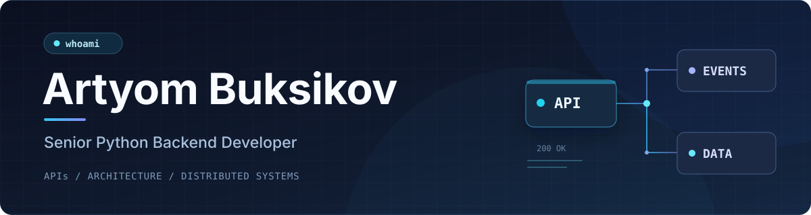

  

  

    
    
  

### About me

I'm a Python backend developer with nearly six years of commercial experience. I work on APIs, system architecture, integrations and asynchronous services — from data models and business logic to performance and reliability.

I care about clear boundaries, maintainable code and sensible technical decisions. Outside my regular backend work, I spend time on computer vision, optimization and interactive systems.

### Languages & tools
#### Backend & APIs

  

#### Messaging, infrastructure & observability

  

#### Development & testing

  

#### Frontend & interactive systems

  

#### Computer vision, ML & optimization

  

### GitHub activity

  

